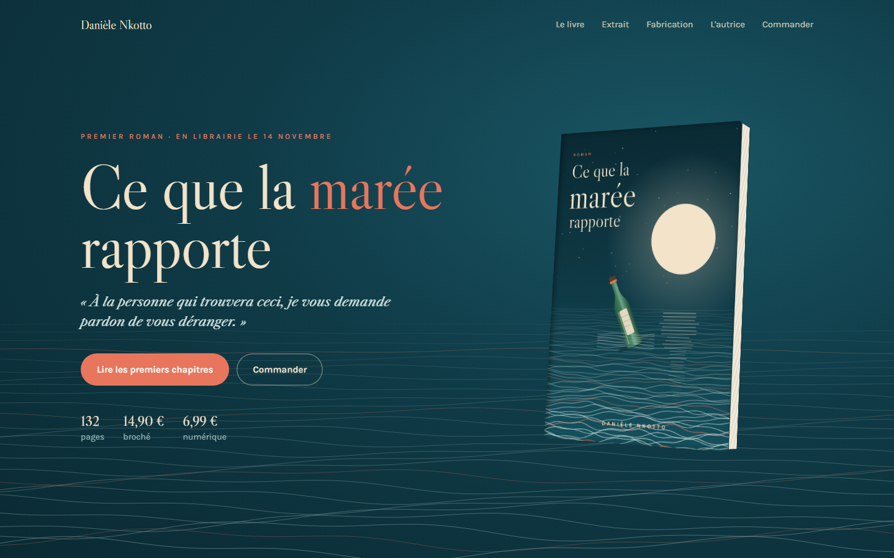
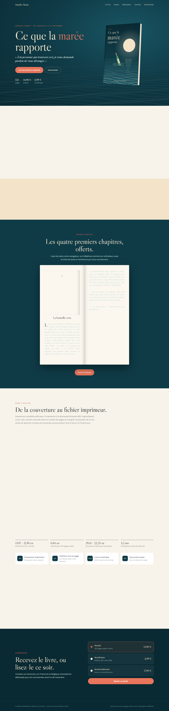

# Ce que la marée rapporte

**Livre · Couverture · Mise en page · Ebook** — Chaîne d'édition complète d'un premier roman : couverture imprimeur (dos, tranche, fond perdu), intérieur mis en page en PDF, EPUB 3, liseuse web et site de lancement avec livre en 3D.

**Démo en ligne : [https://lordlennyx.github.io/maree-livre/](https://lordlennyx.github.io/maree-livre/)**

Spot de présentation (30 s) : [media/spot-30s.mp4](https://lordlennyx.github.io/maree-livre/media/spot-30s.mp4)

## Ce que le projet montre

- Couverture illustrée générée en code, texte vectorisé, tranche calculée selon pages et papier (gabarit KDP / IngramSpark)
- PDF imprimeur à la taille exacte et version avec repères (fond perdu, zones de sécurité)
- Intérieur 5,5 × 8,5 po : pages liminaires, sommaire, lettrines, folios, titres courants, césure
- EPUB 3 valide généré depuis la même source de texte
- Liseuse web paginée : tailles de texte, ambiances jour / sépia / nuit, reprise de lecture, gestes tactiles
- Site du livre : livre 3D interactif, mer animée, extrait en double page, commande

## Réalisation

- **Stack :** Python (fontTools, zipfile), Playwright (PDF), HTML/CSS paged media, JavaScript
- **Texte :** nouvelle originale écrite pour la démonstration
- **Fichiers :** fichiers/ : couverture-imprimeur.pdf, interieur.pdf, EPUB, SVG

| Bureau | Mobile |
|---|---|
|  |  |

---

Client et contenus fictifs, créés pour la démonstration. Conception, design et développement : **Njundiyimun Béchard** — [github.com/LordLennyx](https://github.com/LordLennyx)
